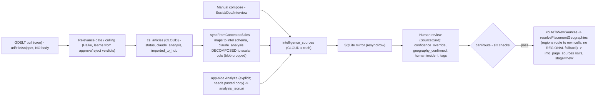

# Intelligence lifecycle: origin -> New Sources

_As of 2026-10-29 (HEAD 1485438). One piece of intelligence from ingest to a routed
info_page_sources row. Point-in-time; the region-routing detail reflects post-
subregional behavior (regions route to their own buckets). Regenerate if the pipeline
changes._

Key facts (see HANDOFF Architecture Notes): two article tables (cs_articles collection
vs intelligence_sources working); GDELT is two-hop, manual is one-hop; collection +
learning loop are Contested-Skies-only; claude_analysis is decomposed to columns on
import, so analysis_json.ai only exists after explicit app-side Analyze.
