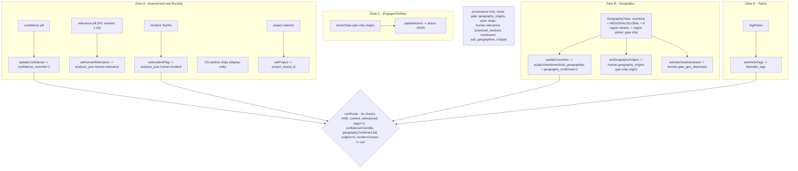

# SourceCard anatomy (data-flow audit)

_As of 2026-10-29 (HEAD 1485438). A component map of the Intelligence SourceCard:
every editable field -> its control -> handler -> writer -> cloud column/path, plus
which fields GATE (feed canRoute) vs are provenance-only. Point-in-time; regenerate
from code if the card changes._

Loose ends found by the audit (banked, see HANDOFF): CS-section chips are display-only
(setRoutingConfirmed writer exists but unwired); the card snippet is the article's own
(not AI-generated); readCloudAnalysis silent-flatten risk across all .human writers.
